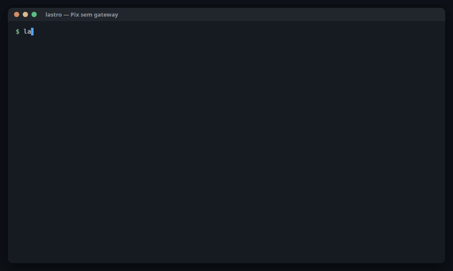

<div align="center">

# Lastro

### Pix without a gateway. Your bank account, your infrastructure, no middleman fee.

**Self-hosted, multi-bank Pix gateway with Pix Automático (recurring Pix).**
One binary that speaks the Central Bank's Pix API, ships an adapter per bank,
handles the mTLS certificates and normalizes webhooks.



[Português](./README.pt-BR.md) · [Docs](./docs) · [Roadmap](https://github.com/orgs/lastrohq/projects/1)

</div>

> 🚧 **Alpha.** The sandbox and the Efí adapter work; the API may still change. Watch the repo or follow the board.

## Try it in 10 seconds

```bash
docker run --rm -p 8080:8080 ghcr.io/lastrohq/lastro sandbox
```

It prints a test API key and a `curl` that creates a Pix charge. Paste it: five
seconds later the fake payer pays and the charge turns `CONCLUIDA`. No bank
account, no config. Without Docker: `go run github.com/lastrohq/lastro/cmd/lastro@latest sandbox`.
See [the sandbox guide (pt-BR)](./docs/SANDBOX.md) for magic values.

## Use it from your agent

`lastro mcp` is an MCP server for AI agents: create, check, list and cancel Pix
charges, and refund payments. It talks to the Lastro API with an API key, so the
key's scopes apply — a read-only key gives you an agent that can only look.

```bash
lastro sandbox   # copy the lst_... key it prints
claude mcp add lastro -e LASTRO_TOKEN=lst_... -e LASTRO_CHAVE_PIX=sandbox@lastro.dev -- lastro mcp
```

Then ask: *"charge R$ 49.90 for order 42 and show me the Pix code"*. Any MCP
client works the same way: run `lastro mcp` over stdio with `LASTRO_URL`
(default `http://localhost:8080`), `LASTRO_TOKEN` and, optionally,
`LASTRO_CHAVE_PIX`.

## Use it from TypeScript

```ts
import { Lastro } from "@lastrohq/sdk";

const lastro = new Lastro({ url: "http://localhost:8080", token: process.env.LASTRO_TOKEN! });
const cob = await lastro.cob.criar({ calendario: { expiracao: 3600 }, valor: { original: "49.90" }, chave: "sandbox@lastro.dev" });
console.log(cob.pixCopiaECola);
```

Typed from the OpenAPI spec, zero dependencies, with webhook signature
verification. See [`sdk/typescript`](./sdk/typescript).

## Why

Payment gateways charge ~1% per Pix, on top of being one more company between
you and your money. Every bank already exposes the official
[BCB Pix API](https://github.com/bacen/pix-api), but each one deviates from it,
requires its own mTLS certificate dance, and sends webhooks in its own shape.

Lastro is the missing layer: you run it, you plug in your own bank credentials,
and your app talks to **one** API no matter which bank receives the money.

## What you pay

Lastro is free and adds nothing per Pix. You pay **your bank's** Pix fee, and
that is the whole bill. How much you save depends on the bank:

| Where the Pix goes through | Fee per Pix | R$ 50 sale | R$ 500 sale |
|---|---|---|---|
| [Stripe](https://stripe.com/br/pricing) (Pix, invite only) | 1.19% | R$ 0.60 | R$ 5.95 |
| [Mercado Pago](https://www.mercadopago.com.br/ferramentas-para-vender/check-out) (checkout, paid instantly) | 0.99% | R$ 0.50 | R$ 4.95 |
| [Asaas](https://www.asaas.com/precos-e-taxas) | R$ 2.15 flat (R$ 1.08 for the first 3 months) | R$ 2.15 | R$ 2.15 |
| **Lastro + [Efí Empresas](https://sejaefi.com.br/tarifas)** | 1.19% (Efí's fee; Lastro adds 0) | R$ 0.60 | R$ 5.95 |

<sub>Public price pages, checked on 29/10/2026. Your negotiated rate may differ.</sub>

**Be honest with yourself:** with Efí, the fee is the same as Stripe's. What
you gain today is ownership — your data, your webhooks, no lock-in, and moving
to another bank without rewriting your integration. The fee drops with banks
that cap or flatten the Pix fee for business accounts; those adapters (Inter,
Sicoob, Banco do Brasil) are next on the board.

## What it does

- **One API, many banks** — Efí today; Inter, Sicoob and Banco do Brasil next. Every adapter passes the same [conformance suite](./CONTRIBUTING.md#suíte-de-conformidade).
- **Charges** — immediate (`cob`) and with due date (`cobv`), BR Code / QR generation built in.
- **Pix Automático** — `rec`, `solicrec`, `cobr` and recurring webhooks.
- **Webhooks that don't get lost** — normalized, signed ([Standard Webhooks](https://www.standardwebhooks.com/)), retried, plus a reconciliation job that recovers missed payments.
- **Refunds** — total or partial, never more than was received.
- **Stateful sandbox** — test the full flow without a business bank account.
- **Single binary** — `docker run` and go; SQLite by default.
- **Use it from your agent** — built-in MCP server (`lastro mcp`).

## Banks

| Bank | `--psp` | cob | cobv | Refund | Webhook | Status |
|---|---|---|---|---|---|---|
| Lastro sandbox | `sandbox` | ✅ | ✅ | ✅ | ✅ | For testing without a business account ([guide, pt-BR](./docs/SANDBOX.md)) |
| Efí | `efi` | ✅ | ✅ | ✅ | ✅ | Tested against Efí's homologation (charges, payment, refund); webhook registration still untested ([guide, pt-BR](./docs/EFI.md)) |
| Inter, Sicoob, Banco do Brasil | — | | | | | Planned |

## Non-custodial

Lastro never holds or moves money. It runs with **your** credentials against
**your** bank account. This is not legal or regulatory advice.

## License

[Apache-2.0](./LICENSE). "Pix" is a trademark of Banco Central do Brasil;
Lastro is an independent project, not affiliated with or endorsed by the BCB.
