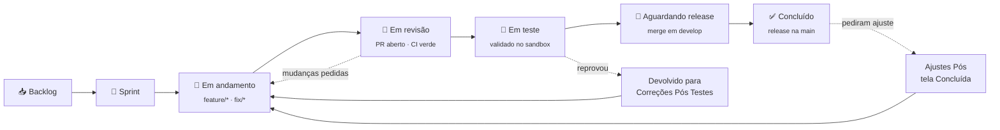

<div align="center">

# 🧭 Lastro — Manual do projeto

### Como o trabalho se organiza: board, fluxo, ritmo e o que conta como "pronto".

<sub>👤 <strong>1</strong> mantenedor + comunidade &nbsp;•&nbsp; 🔁 sprint de <strong>2 semanas</strong> &nbsp;•&nbsp; 📋 board no <a href="https://github.com/orgs/lastrohq/projects">GitHub Projects</a></sub>

</div>

---

## 🎯 Em uma tela

O Lastro tem **um repositório** (monorepo `lastrohq/lastro`) e **um board**. Toda
tarefa começa como issue, vira branch, volta como PR e só fecha quando o merge
acontece. Se não está no board, não existe.

Hoje o projeto tem um mantenedor. O processo é desenhado para isso — review não
bloqueia merge, o CI sim — e para receber contribuição externa sem cerimônia:
o caminho mais comum de contribuição é **um adapter de banco**, e ele tem
template e suíte de conformidade próprios.

**Escopo é defesa contra burnout.** O núcleo é: cobrança, devolução, Pix
Automático, webhooks, conciliação, painel e DX. Pedido fora disso (boleto,
cartão, split, NFS-e, versão hospedada) vira Discussion, não issue — e a
resposta padrão é "não, por enquanto".

---

## 🔁 Ritmo — sprint de 2 semanas

| Cerimônia | Quando | Duração | Para quê |
|---|---|---|---|
| 🗓️ **Planning** | Segunda, início da sprint | ~30 min | Escolher o que entra, estimar, quebrar o que for GG |
| ✅ **Review** | Sexta da 2ª semana | ~20 min | Rodar o que ficou pronto no sandbox e registrar no arquivo do board |
| 🔄 **Retro** | Logo após a review | ~10 min | O que manter, parar, tentar. **No máximo 2 ações** |

Sprint que vira sem terminar não é fracasso — é dado para a próxima estimativa.
Item não terminado volta para o topo do backlog, não é arrastado calado.

---

## 🌊 Fluxo de uma tarefa



1. **Pegue a issue** — mova para `Em andamento` e se atribua.
2. **Crie a branch** a partir de `develop`: `feature/descricao-curta` ou `fix/descricao-curta`.
3. **Commite em Conventional Commits, em pt-BR** — `feat: adiciona adapter do Sicoob`, `fix: corrige CRC do BR Code com valor vazio`.
4. **Abra o PR para `develop`** com `Closes #123` **na mensagem do commit**, não só no corpo do PR.
5. **Espere o CI.** CI vermelho não entra, sem exceção.
6. **Merge em `develop`** → card em `🚀 Aguardando release`.
7. **Release `develop` → `main`** (tag `vX.Y.Z`, goreleaser publica) → card em `✅ Concluído`.

> **Limite de WIP: 2 itens por pessoa** em andamento, contando os devolvidos.

> **Review não bloqueia merge.** O GitHub não deixa o autor aprovar o próprio
> PR; com um mantenedor, o PR é mergeado com CI verde. PR de contribuidor
> externo sempre passa por review do mantenedor.

---

## 📥 Definition of Ready

Uma issue só entra na sprint se:

- [ ] O **problema** está descrito, não só a solução
- [ ] Tem **critérios de aceite** verificáveis (sim/não)
- [ ] Tem **Área**, **Estimativa**, **Módulo** e **Fase** no board
- [ ] Não depende de nada que ainda não existe — ou a dependência está linkada
- [ ] Se mexe em regra de negócio: a RN está escrita ou a issue diz qual RN muda
- [ ] Se mexe em tela: segue o [design system](./DESIGN-SYSTEM.md) ou traz a referência

## 📤 Definition of Done

- [ ] Critérios de aceite atendidos
- [ ] **CI verde** (`Lint & Test`)
- [ ] Teste automatizado cobrindo o comportamento novo — ou justificativa no PR
- [ ] Adapter novo/alterado passa na suíte de conformidade
- [ ] Rota nova/alterada no `api/openapi.yaml`
- [ ] Regra nova/alterada em [`REGRAS-DE-NEGOCIO.md`](./REGRAS-DE-NEGOCIO.md)
- [ ] Decisão de arquitetura registrada em ADR
- [ ] Nenhum segredo ou dado real em diff, fixture ou log
- [ ] Docs atualizadas, se o comportamento mudou

---

## 📋 Como o board funciona

| Coluna | O que significa |
|---|---|
| **📥 Backlog** | Existe, mas ninguém prometeu quando |
| **🎯 Sprint** | Combinado para esta sprint, ainda não começou |
| **🔨 Em andamento** | Alguém está com a mão nisso agora |
| **👀 Em revisão** | PR aberto |
| **🧪 Em teste** | Código aprovado, validando no sandbox / homologação do banco |
| **Devolvido para Correções Pós Testes** | Reprovou no teste e voltou. O que reprovou fica escrito na issue |
| **🚀 Aguardando release** | Mergeado na `develop`, ainda não está na `main` |
| **✅ Concluído** | Publicado num release |
| **Ajustes Pós tela Concluída** | Já entregue, voltou com pedido de ajuste |
| **Cancelado** | Decidido não fazer — o porquê fica escrito na issue |

> **Duas colunas de volta** porque card que voltou não é card novo: ele rodou o
> fluxo inteiro e falhou em algum ponto. Retrabalho invisível faz a estimativa
> da próxima sprint mentir.

| Campo | Valores |
|---|---|
| **Área** | Core · Adapters PSP · API · Painel · Design · DX/Docs · Infra/CI · Segurança · Comunidade/Marketing · Estudo |
| **Estimativa** | `P` (até meio dia) · `M` (1–2 dias) · `G` (3+ dias) · `GG` (quebra antes de entrar) |
| **Prioridade** | Alta · Média · Baixa |
| **Sprint** | Iteração de 2 semanas |
| **Módulo** | core · psp · api · painel · brcode · sdk · mcp · docs · QA / Teste · Processo |
| **Fase** | F0 Fundação → F10 Lançamento (ver abaixo) |

> **Módulo substitui o "Repositório" do Só+1**, porque aqui é monorepo. Ele
> responde *que tipo de trabalho é esse*: teste vai para `QA / Teste` mesmo
> quando o código nasce em `internal/`; board, docs de processo e rito vão para
> `Processo`.

### Fases

| Fase | Entrega |
|---|---|
| **F0 · Fundação** | Repo, CI, docs, board, estudo de `/rec`/`/cobr` |
| **F1 · Domínio & BR Code** | `Money`, `Txid`, máquinas de estado, `pkg/brcode` |
| **F2 · Cobranças** | Ports, store SQLite, `cob`/`cobv`, API keys, idempotência |
| **F3 · Sandbox com estado** | Adapter sandbox, `lastro sandbox` |
| **F4 · Webhooks & conciliação** | Entrada, outbox, retry, DLQ, assinatura, conciliação |
| **F5 · Adapters reais** | Certificados, OAuth2, Efí, Inter, Sicoob, BB, conformidade |
| **F6 · Pix Automático** | `rec`, `solicrec`, `cobr`, `webhookrec` |
| **F7 · Devoluções** | Devolução com limites e prazos |
| **F8 · Painel** | Design system + telas do MVP |
| **F9 · DX** | SDK TS, MCP, site de docs, `docker run` de um comando |
| **F10 · Lançamento** | README com GIF, social preview, posts, awesome lists |

### Quando o card sai do board

Ao fim da sprint, os cards em `✅ Concluído` são registrados no
[arquivo do board](./ARQUIVO-DO-BOARD.md) — issue, PR, commit de merge e
release — e **só então** arquivados.

---

## 🌿 Convenções

**Branches** — `main` (releases) ← `develop` (integração) ← `feature/*` · `fix/*`.
`main` e `develop` protegidas: check `Lint & Test` obrigatório, sem force push,
vale inclusive para admin, zero aprovações obrigatórias.

**Commits** — [Conventional Commits](https://www.conventionalcommits.org/) em pt-BR:

```
feat: adiciona cobrança com vencimento no adapter do Inter
fix: corrige deduplicação de webhook por endToEndId
test: cobre transições inválidas da recorrência
docs: registra ADR do outbox
refactor: extrai cache de token OAuth2 para platform
chore: atualiza golangci-lint
```

**Issues** — use os templates. Título descreve o resultado: *"Pix recebido sem
webhook aparece em até 5 minutos"* vale mais que *"criar job de conciliação"*.

**Versão** — SemVer. Antes da `v1.0.0`, minor pode quebrar contrato — e quebra
sempre vem anotada no release.

**Releases amarrados a eventos regulatórios** — normativo novo do BCB sobre Pix
vira issue (com link da norma), release e nota.
